# 🚀 Awesome-Container-Operating-Systems

  

  
  
  
  
  

---

## 🧭 Top Container Operating Systems Ecosystem

**Curated List of Production SaaS Platforms & Open-Source GitHub Projects**  
*Focused on Immutable Infrastructure, Minimal Attack Surface, Atomic A/B Updates & Container-Optimized Linux Appliances*  

**Last updated: October 2026** ⚡

---

### 🔍 Overview & Architecture

This repository tracks notable **SaaS platforms** and **open-source projects** for **Container Operating Systems (Container OS)**. These systems enable DevOps, SRE, and platform engineering teams to host mission-critical containerized workloads on minimal, immutable, and security-hardened Linux distributions—ranging from general-purpose container hosts to API-driven, shell-less Kubernetes appliances engineered for zero-touch cloud and edge operations.

- **Primary Focus Areas**: Immutability (`/usr` and `/root` read-only), transactional updates with automatic rollbacks, minimal userland footprints, container runtime optimizations (containerd, CRI-O, Docker), and Kubernetes-first host architectures.
- **Ecosystem Standouts**: Flatcar Container Linux, Talos Linux, AWS Bottlerocket, NixOS, LinuxKit, Red Hat Enterprise Linux CoreOS, Fedora CoreOS, SUSE MicroOS, Ubuntu Core, Alpine Linux, Photon OS, Kairos, Project Bluefin, and Bootc.
- **Open-Source Emphasis**: Heavily expanded with active repositories for self-hosting, immutable bare-metal infrastructure, and Kubernetes appliances—empowering operators to avoid vendor lock-in.

Contributions are warmly welcome! Open a PR to add or update entries. Keep descriptions factual and link directly to official repositories and documentation.

---

## 📑 Table of Contents

- [📊 Sector Overview & Market Dynamics](#-sector-overview--market-dynamics)
- [☁️ SaaS / Hosted Platforms](#️-saas--hosted-platforms)
- [📦 Open-Source GitHub Projects (Ranked by Stars)](#-open-source-github-projects-ranked-by-stars)
- [📈 Star History](#-star-history)
- [💖 Support & Sponsorship](#-support--sponsorship)
- [🤝 How to Contribute](#-how-to-contribute)
- [⚖️ Disclaimer](#️-disclaimer)

---

## 📊 Sector Overview & Market Dynamics

The global container management and container software market is estimated at **$11.0 billion in 2024–2026** and projected to surge past **$24–$34 billion by 2030–2032** at an estimated CAGR of ~20–25%. The market dynamics are **moderately concentrated to oligopolistic at the hyperscaler runtime layer** (dominated by Microsoft Azure, Google Cloud, and AWS alongside enterprise linchpins like Red Hat/IBM), while remaining **moderately fragmented across specialized bare-metal orchestration, edge computing, and immutable OS tooling** where agile open-source innovators compete.

---

## ☁️ SaaS / Hosted Platforms

*Below are production-ready managed platforms and container OS control planes, sorted in descending order by parent company valuation / market scale:*

| Platform / Service | Provider | Company Valuation / Revenue | Pricing (Starting Tier) | Free Tier Limits | Description |
| :--- | :--- | :--- | :--- | :--- | :--- |
| **[Azure Kubernetes Service (AKS) Node Images](https://azure.microsoft.com/en-us/products/kubernetes-service)** | Microsoft | **$3.1+ Trillion Market Cap** ($245B+ Annual Revenue) | **$0.10/cluster/hour** (Standard tier cluster management fee; worker nodes billed at underlying Azure VM compute rates starting at ~$0.0104/hr for B1s) | **Free tier available**: 1 cluster free with cluster management fee waived ($0/hr cluster management on Free Tier); pay only for worker VMs. In addition, Azure offers a $200 credit (valid for 30 days) plus 12 months of popular free services for new accounts. | Managed cloud container node images (Ubuntu and Azure Linux / CBL-Mariner) optimized for Kubernetes with automatic patching, node auto-repair, and seamless Azure integrations. |
| **[Google Kubernetes Engine (GKE) COS](https://cloud.google.com/container-optimized-os)** | Google / Alphabet | **$2.2+ Trillion Market Cap** ($307B+ Annual Revenue) | **$0.10/cluster/hour** (Cluster management fee; worker nodes billed at underlying GCE Compute Engine rates, e.g., e2-micro from ~$0.0084/hr) | **Free tier available**: $74.40 monthly cluster management credit applied per billing account (covers 1 zonal or Autopilot cluster completely free forever). In addition, Google Cloud offers a $300 free trial credit for 90 days. | Google's Container-Optimized OS (COS) pre-installed on managed GKE nodes; immutable, ChromiumOS-derived, security-hardened Linux distribution maintained by Google. |
| **[Amazon EKS Bottlerocket / AMI](https://aws.amazon.com/eks/)** | Amazon / AWS | **$2.0+ Trillion Market Cap** ($575B+ Annual Revenue) | **$0.10/cluster/hour** (Standard EKS cluster control plane fee; node instances billed at standard EC2 rates, e.g., t4g.nano at ~$0.0042/hr) | **Free trial only**: 12 months free tier on AWS including 750 hours/month of t2.micro or t3.micro EC2 compute; EKS cluster control plane fee ($0.10/hr) has no perpetual free tier. | Pre-configured AMIs featuring Bottlerocket and Amazon Linux with dual-partition updates, no default shell, and tight integration with AWS security services. |
| **[Red Hat OpenShift Service on AWS (ROSA)](https://aws.amazon.com/rosa/)** | Red Hat / IBM | **$210+ Billion Market Cap** (IBM) / ~$5B+ Annual Revenue (Red Hat) | **$0.25/hour** (Cluster fee for Hosted Control Planes / HCP plus $0.171 per 4 vCPU-hours worker node fee; ROSA Classic has $0 hourly cluster fee, requiring minimum 3 master and 2 worker EC2 instances) | **Free trial only**: 60-day self-managed OpenShift trial on Red Hat Hybrid Cloud Console with full cluster features (underlying cloud infrastructure fees apply). | Managed OpenShift platform powered by immutable RHEL CoreOS (RHCOS) nodes with automated over-the-air updates, SELinux enforcement, and enterprise compliance. |
| **[Ubuntu Pro for Cloud / Core](https://ubuntu.com/pro)** | Canonical | **$1.5B–$2.0B Est. Valuation** (~$345M Annual Revenue) | **$25.00/machine/year** (Physical workstations) or **$500.00/server/year** (Physical servers); on AWS/Azure/GCP billed as a compute surcharge of ~3% to 4.5% of underlying VM cost (~$0.001–$0.015/hr) | **Free tier available**: Free for up to 5 physical/virtual machines for personal and small-scale use with full 10-year security maintenance and Livepatch. | Enterprise and IoT container-optimized OS management with cryptographic snap confinement, transactional updates, and extended 10–15 year security patching. |
| **[Talos Omni](https://www.siderolabs.com/platform/saas-omni/)** | Sidero Labs (Yardi) | **~$30M–$50M Est. Valuation** ($7.7M–$8.7M VC raised, acquired by Yardi) | **$1,000.00/node/year** (Commercial / Production tier with 10-node minimum commitment; ~$83.33/node/month) | **Free tier available**: Omni Hobby plan is 100% free forever for up to 10 nodes and 2 user accounts with UI upgrades, WireGuard secure node mesh, and scheduled etcd backups. | Managed SaaS control plane for Talos Linux bare-metal and hybrid Kubernetes clusters, providing API-driven lifecycle management, zero-touch provisioning, and automated upgrades. |

---

## 📦 Open-Source GitHub Projects (Ranked by Stars)

*All open-source container operating system repositories below are ordered in descending order by GitHub stargazer count. Each Stars_Badge links directly to the stargazer community of that repository:*

### 1. ❄️ **[NixOS](https://github.com/NixOS/nixpkgs)** 
- **License**: MIT
- **Architecture & Highlights**: Purely functional Linux distribution engineered for deterministic, reproducible system builds. Employs atomic upgrades, cryptographic closures, and instantaneous system rollbacks. Widely deployed alongside immutable container hosts for hermetic system configuration and container image compilation.

### 2. ⚡ **[Talos Linux](https://github.com/siderolabs/talos)** 
- **License**: MPL-2.0
- **Architecture & Highlights**: **The modern Kubernetes appliance OS**. Entirely API-driven, immutable, and minimal userland written in Go. Ships with no shell, no SSH daemon, and only 12 userspace binaries. Controlled strictly over gRPC using `talosctl`. Features staged networking, userspace OOM handling, air-gapped registry caching, dual-partition A/B upgrades, and strict SELinux enforcement.

### 3. 🛡️ **[Bottlerocket](https://github.com/bottlerocket-os/bottlerocket)** 
- **License**: Apache-2.0
- **Architecture & Highlights**: **AWS's container-optimized OS for Amazon EKS and ECS**. Built in Rust with a read-only root filesystem, no interactive shell by default, and cryptographically verified kernel modules. Integrates dual-partition A/B updates, NVIDIA Multi-Instance GPU (MIG) partitioning, and AWS Neuron accelerator support for deep learning workloads.

### 4. 🧰 **[LinuxKit](https://github.com/linuxkit/linuxkit)** 
- **License**: Apache-2.0
- **Architecture & Highlights**: A toolkit initiated by Docker for building custom, minimal, immutable Linux subsystems assembled entirely out of container images. Generates lean bootable appliances (ISO, cloud AMIs, PXE) with read-only root filesystems and sandboxed services.

### 5. 🚜 **[RancherOS](https://github.com/rancher/os)** 
- **License**: Apache-2.0
- **Architecture & Highlights**: **Pioneering container host operating system**. Ran everything above the Linux kernel as Docker containers (system Docker and user Docker). Currently in archive / maintain-only mode as modern infrastructure standardizes on CRI-O and containerd runtimes.

### 6. 🪶 **[k3OS](https://github.com/rancher/k3os)** 
- **License**: Apache-2.0
- **Architecture & Highlights**: Lightweight Linux appliance built by Rancher exclusively to run and manage K3s clusters. Configured via single cloud-init YAML, with immutable root filesystem and zero local package management overhead.

### 7. 🚀 **[Photon OS](https://github.com/vmware/photon)** 
- **License**: Apache-2.0
- **Architecture & Highlights**: **VMware's container host OS optimized for hypervisors and cloud platforms**. Features a custom Linux kernel tuned for VMware ESXi performance, `tdnf` package manager, Photon Management Daemon (`pmd`), Cgroup v2, container runtime security, and native support for Docker and Kubernetes.

### 8. 🐋 **[Project Bluefin](https://github.com/ublue-os/bluefin)** 
- **License**: Apache-2.0
- **Architecture & Highlights**: Cloud-native, immutable container operating system image built upon Fedora Atomic Desktop and bootc. Provides an atomic, OCI container image update mechanism designed for cloud-native workstations and edge container hosts.

### 9. 🥾 **[bootc](https://github.com/containers/bootc)** 
- **License**: Apache-2.0
- **Architecture & Highlights**: **Transactional bootable container images**. Red Hat/Fedora tool that allows full operating systems to be built, shipped, and executed directly as standard OCI container images, enabling GitOps deployment of host operating systems using standard container registries.

### 10. 🧱 **[Kairos](https://github.com/kairos-io/kairos)** 
- **License**: Apache-2.0
- **Architecture & Highlights**: **The immutable Linux meta-distribution**. Transforms any Linux distribution (openSUSE, Ubuntu, Alpine, Fedora, Debian) into an immutable, self-updating appliance. Supports P2P distributed cluster installations, cloud-init configuration, and Kubernetes automation for edge computing.

### 11. 🏔️ **[Docker Alpine](https://github.com/alpinelinux/docker-alpine)** 
- **License**: MIT
- **Architecture & Highlights**: Official base image infrastructure for **Alpine Linux**, the industry's default ultra-lightweight (~5MB) base for containerized workloads. Relies on `musl libc` and `busybox` for minimal surface area and high vulnerability resilience.

### 12. 🚃 **[Flatcar Container Linux](https://github.com/flatcar/Flatcar)** 
- **License**: Apache-2.0
- **Architecture & Highlights**: **The community-driven, production standard for immutable container Linux**. Spiritual successor to CoreOS Container Linux, created by Kinvolk. Read-only `/usr`, automatic Omaha-protocol updates via Update Engine with automatic rollback, SELinux enforcing, Ignition provisioning, and zero package manager. Proven in enterprise deployments managing 20,000+ nodes at Adobe.

### 13. 🏔️ **[Alpine Aports](https://github.com/alpinelinux/aports)** 
- **License**: MIT
- **Architecture & Highlights**: Upstream package build definitions for Alpine Linux. Powers security-hardened container host appliances and minimal base images across the cloud-native ecosystem.

### 14. 🏎️ **[Clear Linux OS](https://github.com/clearlinux/distribution)** 
- **License**: GPL-3.0 / Multi-license
- **Architecture & Highlights**: Intel-optimized Linux distribution built for high-performance compute and container virtualization. Features stateless system design (`/usr` separated from `/etc` and `/var`) and aggressive AVX-512 compiler optimizations.

### 15. 🛠️ **[CoreOS Assembler (COSA)](https://github.com/coreos/coreos-assembler)** 
- **License**: Apache-2.0
- **Architecture & Highlights**: Primary build and release tooling for Fedora CoreOS and Red Hat Enterprise Linux CoreOS. Assembles bootable OSTree images, cloud AMIs, and bare-metal installer ISOs using containerized build pipelines.

### 16. 🎩 **[Fedora CoreOS Tracker](https://github.com/coreos/fedora-coreos-tracker)** 
- **License**: Apache-2.0
- **Architecture & Highlights**: **Automatically updating, monolithic, minimal container OS**. Successor to CoreOS Container Linux in the Fedora community. Employs `Ignition` for declaration-first boot configuration and `rpm-ostree` for transactional updates. Serves as upstream for RHEL CoreOS.

### 17. 🦎 **[openSUSE Transactional Update](https://github.com/openSUSE/transactional-update)** 
- **License**: GPL-2.0
- **Architecture & Highlights**: The core transactional engine behind **SUSE MicroOS** and **openSUSE Leap Micro**. Creates isolated Btrfs root filesystem snapshots where updates and packages are staged atomically and activated upon reboot, guaranteeing instantaneous rollbacks if health checks fail.

### 18. 🔴 **[Red Hat Enterprise Linux CoreOS (RHCOS)](https://github.com/openshift/os)** 
- **License**: Apache-2.0
- **Architecture & Highlights**: **Enterprise immutable container host for OpenShift**. Managed declaratively through Kubernetes via the Machine Config Operator. RHCOS 10 introduces multi-OS stream support via `OSStreams` CRD for zero-downtime rolling node migrations, sealed image integrity (fs-verity), and post-quantum cryptographic algorithms.

### 19. 🐧 **[Ubuntu Core](https://github.com/canonical/ubuntu-core-desktop)** 
- **License**: GPL-3.0
- **Architecture & Highlights**: **Minimal, immutable container OS with up to 15 years of security maintenance**. Built entirely from sandboxed, cryptographically-signed snap packages with a tamper-proof measured boot chain. Ideal for edge gateways, smart IoT devices, and distributed AI vision appliances complying with the EU Cyber Resilience Act.

### 20. 🦎 **[SUSE MicroOS Tools](https://github.com/openSUSE/microos-tools)** 
- **License**: GPL-2.0
- **Architecture & Highlights**: Setup and orchestration tooling for **SUSE MicroOS**. Configures read-only root filesystems, SELinux policies, ignition support, and container engine runtime orchestration for automated host deployments.

---

## 📈 Star History

---

## 💖 Support & Sponsorship

Thank you for visiting and supporting the **Awesome Container Operating Systems** directory!

- ⭐ **Star this repository** if you found it useful for your infrastructure stack!
- 🍴 **Fork and contribute** new container operating systems, immutable distributions, or platform benchmarks.
- 📢 **Share** with your platform engineering, DevOps, and cloud-native communities.
- ☕ **Support the maintainer**: Buy a coffee or become a sponsor at the [GitHub Sponsors Dashboard](https://github.com/sponsors/ishandutta2007).

---

## 🤝 How to Contribute

1. Fork this repository.
2. Add or update container OS entries in `README.md` keeping the sorted stargazer order.
3. Include: project name, GitHub link, stargazer social badge, license, and 2–3 factual sentences outlining immutability, update mechanisms, and target runtime workloads.
4. Submit a Pull Request with a clear explanation of your additions.

---

## ⚖️ Disclaimer

- This is an independent **community-curated** catalog — not an endorsement of specific vendors or distributions.
- Production systems running containerized workloads must comply with security best practices, zero-trust network boundaries, and organizational policies.
- Immutable operating systems require disciplined operational workflows: test automated node upgrades in staging environments before promoting rollouts across production clusters.

---

  <b>Built with ❤️ for platform engineers, SREs, and Kubernetes operators worldwide.</b> 
  Let's make Container Operating Systems more secure, automated, and immutable.

# Awesome-Container-Operating-Systems

